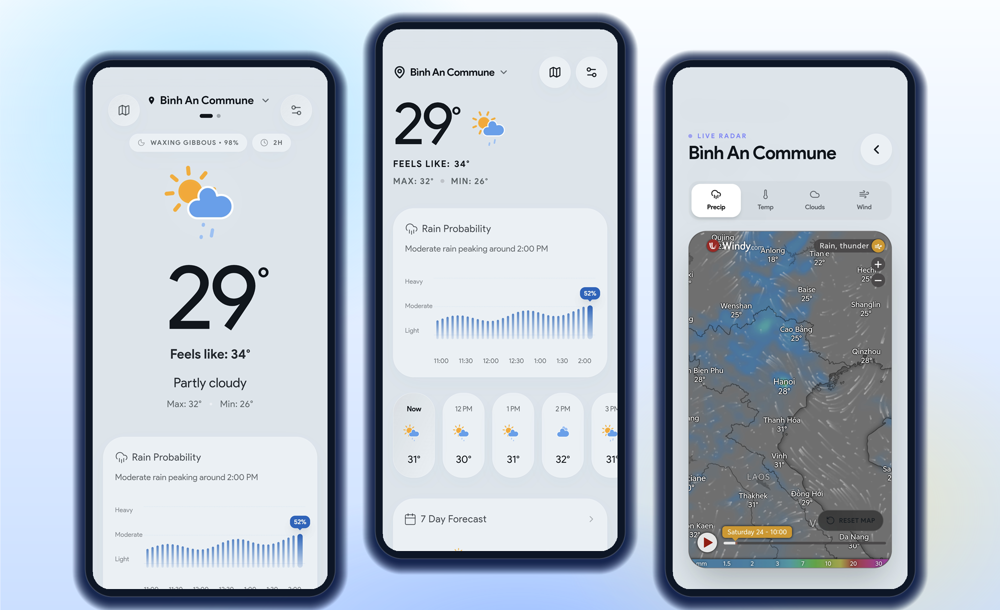
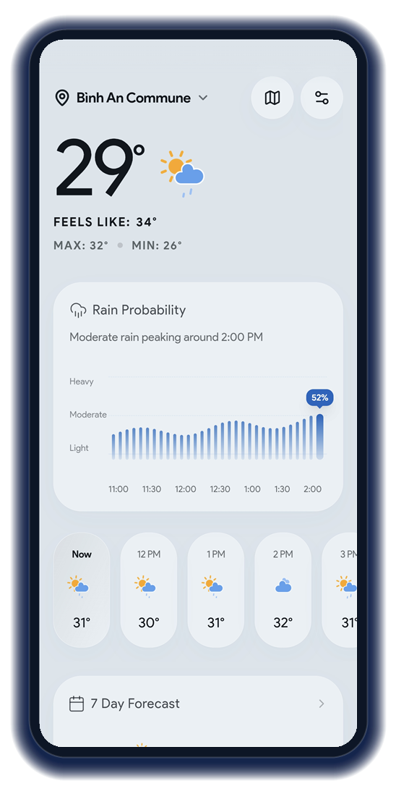
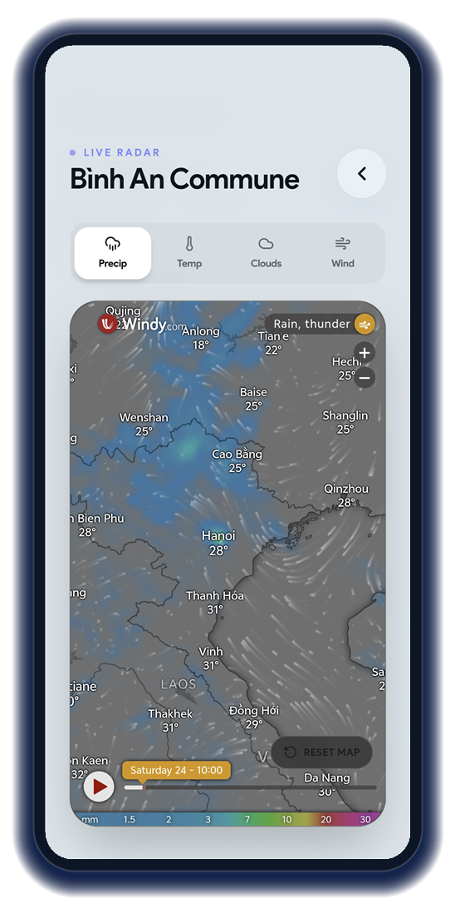
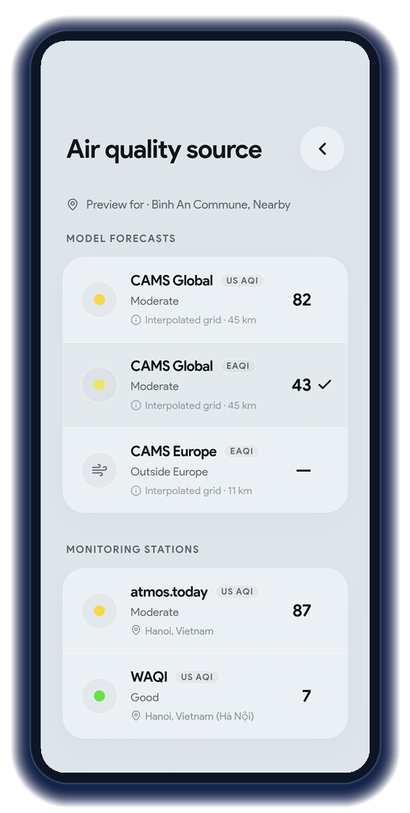
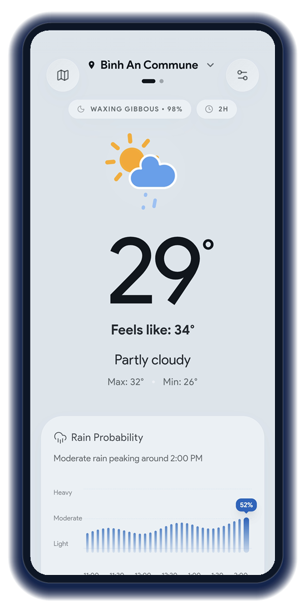
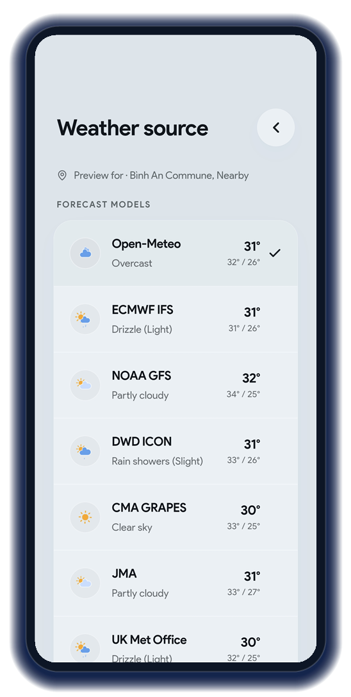
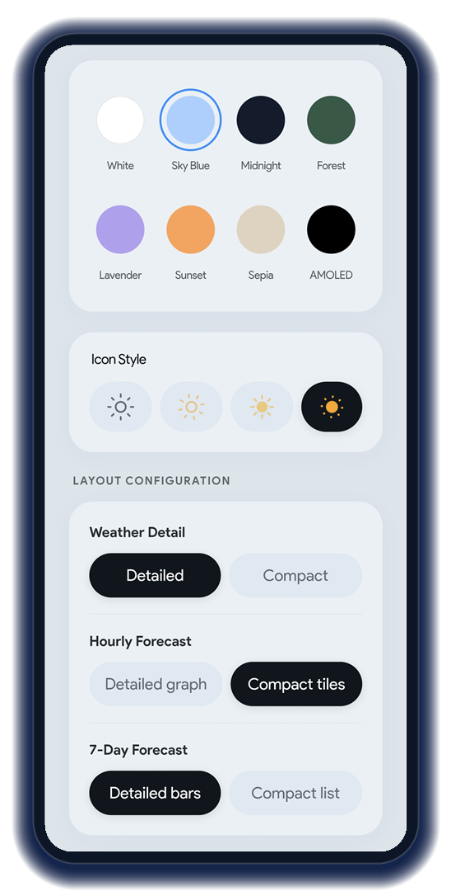

<p align="center">
  
</p>

<h1 align="center">Solnim</h1>

<p align="center">
  A clean weather app: real-time conditions, hourly and 7-day forecasts, air quality, UV index
  and live radar. Fast, ad-free, no account.
</p>

<p align="center">
  <a href="https://github.com/ngocthanhgl/solnim/releases/latest"></a>
  
  
</p>

<p align="center">
  
  
  
</p>

<table>
<tr>
<td width="33%" align="center"><b>Everything at a glance</b><br><sub>Current conditions, rain probability, hourly tiles and the 7-day forecast on one scrollable screen.</sub></td>
<td width="33%" align="center"><b>Live radar</b><br><sub>Windy radar inside the app, with precipitation, temperature, clouds and wind layers.</sub></td>
<td width="33%" align="center"><b>Honest air quality</b><br><sub>Five sources, each with its own index scale. Stations show the real station city; models are labelled as interpolated grids.</sub></td>
</tr>
</table>

---

## Screenshots

<p align="center">
  
  
  
</p>

<table>
<tr>
<td width="33%" align="center"><b>Two layouts</b><br><sub>Detailed or compact weather block, graph or tiled hourly forecast, bars or list for 7 days.</sub></td>
<td width="33%" align="center"><b>Compare 15 forecast models</b><br><sub>Open-Meteo, ECMWF IFS, NOAA GFS, DWD ICON, CMA GRAPES, JMA, UK Met Office and more — side by side, then pick yours.</sub></td>
<td width="33%" align="center"><b>Make it yours</b><br><sub>Light and dark themes, 8 accent colours including AMOLED black, 4 icon styles, 17 languages.</sub></td>
</tr>
</table>

## Features

- **Real-time weather** — temperature, feels-like, humidity, precipitation, visibility, wind, pressure
- **Hourly and 7-day forecast** with switchable icons (animated, static, outline)
- **Air quality** — five sources with their own index scale (US EPA, European EEA, CPCB): CAMS Global
  (US + EU), CAMS Europe, atmos.today and WAQI ground stations
- **Weather source picker** — compare 15 forecast providers, then choose the one the app uses
- **Detail tiles** you can reorder and hide: air quality, UV index, sun and moon, pollen, rain graph
- **Live radar** with a map reset control for when a pinch gesture gets stuck
- **Multi-city** — swipe between cities, background location refresh, optional push alerts for
  rain, snow, storms, severe weather and air quality thresholds
- **Offline friendly** — cached forecasts and last-known data are shown instantly on launch

## Data sources

| Data | Source |
|------|--------|
| Weather | [Open-Meteo](https://open-meteo.com) model families (ECMWF, GFS, ICON, CMA, JMA, UKMO, Météo-France, GEM, KNMI, DMI), plus MET Norway and wttr.in |
| Air quality | CAMS via Open-Meteo, [atmos.today](https://atmos.today) and WAQI/AQICN ground stations (through a server-side proxy) |
| Geocoding | Open-Meteo geocoding (GeoNames) and Photon (OpenStreetMap), with Nominatim as a last resort |
| Radar | [Windy](https://windy.com) embed |
| Icons | [amCharts](https://amcharts.com) weather icons, [Lucide](https://lucide.dev) |

Model-based air quality rows are labelled as interpolated grids (45 km for CAMS Global, 11 km for
CAMS Europe); rows from real monitors show the station city instead.

## Install

**Android** — download the signed APK from the [latest release](https://github.com/ngocthanhgl/solnim/releases/latest)
and open it. Android will ask you to allow installing from this source.

> The package is `app.solnim.weather`. If you had a previous build of this app installed under a
> different package name, uninstall it first — they are separate apps.

**Web** — the app is a PWA and can be served from any static host after `npm run build`.

## Development

```bash
npm ci
npm run dev      # Vite dev server
npm run build    # web app -> dist/, plus the bundled Node server
```

Requirements: Node.js 22+ (the Android SDK is only needed for the APK).

Optional environment variables:

| Variable | Purpose |
|----------|---------|
| `AQICN_TOKEN` | WAQI/AQICN token. Used at build time (stored scrambled in the bundle) or by the proxy in `api/`. |
| `VITE_AQI_PROXY_BASE` | Public base URL of an AQICN proxy. When set, the app calls the proxy instead of carrying the token. |
| `GEMINI_API_KEY` | Translation and feedback endpoints in `server.ts`. |

## Android build

The APK is built by [`.github/workflows/build-apk.yml`](.github/workflows/build-apk.yml): it builds
the web app, scaffolds Capacitor, applies the launcher resources from `brand/launcher/res`, removes
the splash art, disables the WebView scrollbars natively, signs with the release keystore and
publishes a GitHub Release.

## Project layout

```
src/            React app (components, services, providers, lib)
api/            Serverless functions (proxies, cron)
brand/          Logo, icons, social preview, Android launcher resources
docs/showcase/  Screenshots used by this README
public/         Static assets served by the web app
.github/        CI: signed APK build and release
```

## Brand

Logo, icon and colour palette: [`brand/BRAND.md`](brand/BRAND.md).

## Licence

MIT. Solnim is a fork of [aryannvx/overcast](https://github.com/aryannvx/overcast) (MIT) — the
original copyright notice is retained, with thanks to its author and to the data providers above.
